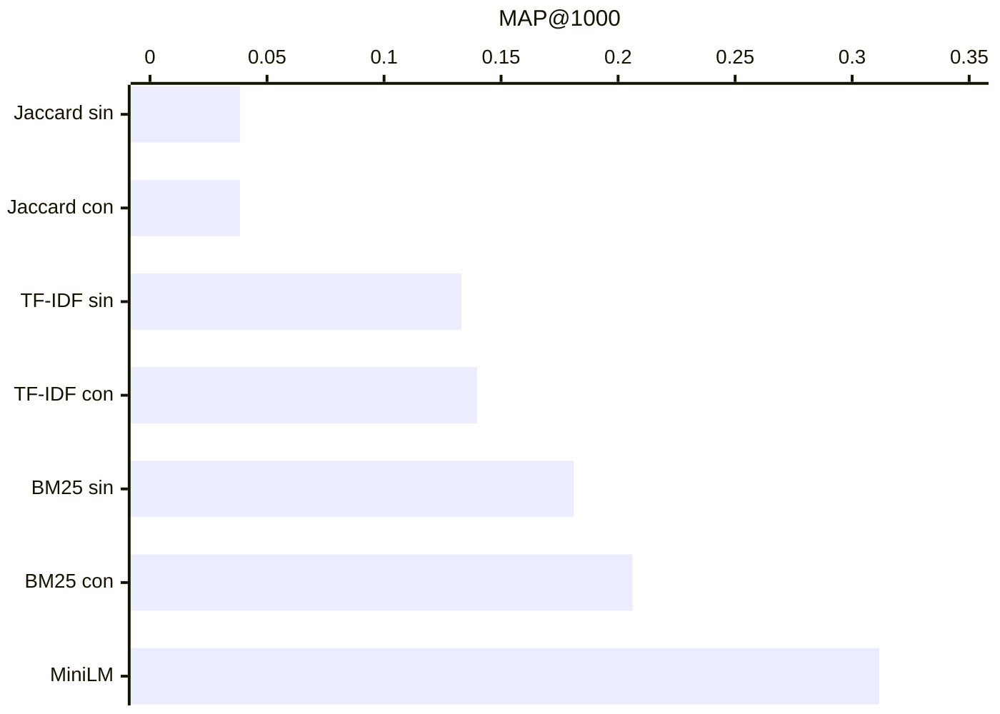

**Escuela Politécnica Nacional**

# Recuperación de información en FiQA

Comparación de Jaccard, TF-IDF, BM25 y MiniLM con búsqueda exacta

**Integrantes.** Ismael Freire, Johann Pasquel y Jorge Torres.

Recuperación de Información · Prof. Iván Carrera

**Resumen.** Evaluamos siete configuraciones con las mismas 648 consultas de prueba de FiQA. MiniLM obtuvo el mayor MAP@1000 (0,311586) y BM25 con Porter fue el mejor método léxico (0,206219). Los contrastes pareados respaldan la ventaja de MiniLM y el efecto de Porter en BM25. Cuatro consultas ilustran qué cambia en el ranking y el análisis por grupos muestra dónde conviene matizar el promedio.

## 1. Descripción del corpus utilizado

Usamos FiQA en la distribución de BEIR [1, 2], con el corpus y los juicios de relevancia entregados en la asignatura [3]. Las consultas y los documentos están en inglés y cubren preguntas financieras sobre inversión, impuestos y crédito, entre otros temas. Cada documento conserva su identificador `doc_id` y un campo de búsqueda que combina título y texto. Los juicios de relevancia, o *qrels*, vinculan el identificador de consulta `qid` con los documentos juzgados relevantes.

**Tabla 1.** Composición de FiQA.

| Elemento | Cantidad | Interpretación |
| --- | ---: | --- |
| Documentos | 57 638 | Corpus completo |
| Consultas | 6 648 | 5 500 de entrenamiento, 500 de validación y 648 de prueba |
| Consultas evaluadas | 648 | Partición de prueba, compartida por las siete configuraciones |
| Pares consulta-documento juzgados en prueba | 1 706 | Todos con relevancia binaria igual a 1 |

Los títulos están vacíos y 38 documentos carecen de texto. Se conservan para mantener la colección y sus juicios, incluido el documento `117276`, relevante para la consulta `5206`. Cada consulta de prueba tiene entre 1 y 15 documentos juzgados relevantes, con una mediana de 2. Si las dos respuestas relevantes aparecen entre las diez primeras, el recall llega a 1 y la precisión es 0,2.

## 2. Explicación de las decisiones de diseño

### 2.1. Preprocesamiento e índice

Aplicamos el mismo procesamiento léxico a corpus y consultas para que compartan vocabulario. Pasamos el texto a minúsculas, lo tokenizamos con NLTK y filtramos las *stopwords* (palabras vacías) en inglés para reducir coincidencias poco informativas. Porter agrupa variantes morfológicas [4]. Lo dejamos opcional para medir su efecto con los demás ajustes fijos, pues una reducción de sufijos también puede unir formas con significados distintos. En el corpus reduce el vocabulario de 78 115 a 57 620 términos (26,24 %).

El índice invertido propio guarda la frecuencia de cada término en un documento (*f*), el número de documentos donde aparece (*df*) y la longitud de cada documento (*dl*). Los tres modelos léxicos reutilizan esas estadísticas. El tokenizador conserva `401k`, separa `goog-stock` en dos términos y divide `3.5` en `3` y `5`, con pérdida del valor decimal original.

<!-- pagebreak -->

### 2.2. Modelos léxicos

**Jaccard binario.** Mide la coincidencia entre los conjuntos de términos de la consulta (*Q*) y del documento (*D*). Cada término cuenta una vez. Los términos desconocidos de la consulta cuentan en la unión [5].

$$J(Q,D)=\frac{|Q\cap D|}{|Q\cup D|}$$

**TF-IDF.** La TF logarítmica atenúa las repeticiones. Usamos IDF sin suavizado porque el vocabulario del índice ya tiene frecuencia documental positiva. Si un término aparece en los *N* documentos, su peso es cero. Ponderamos consulta y documento del mismo modo y los normalizamos con L2 para compararlos por coseno [5]. Los términos ausentes tienen TF cero y una consulta de norma cero produce un ranking vacío.

$$\mathrm{tf}(t,d)=1+\ln(f_{t,d})\quad(f_{t,d}>0),\qquad
\mathrm{idf}(t)=\ln\frac{N}{df_t},\qquad
\cos(Q,D)=\frac{\sum_{t\in Q\cap D}w_{Q,t}\,w_{D,t}}{\|Q\|_2\,\|D\|_2}$$

**BM25.** Fijamos k₁ = 1,5 para moderar el aporte de las repeticiones y b = 0,75 para corregir parcialmente la longitud respecto a la media (*avgdl*) [6]. Mantuvimos ambos valores al comparar Porter. Sumar 1 al cociente dentro del logaritmo hace que un término muy frecuente aporte una puntuación positiva, aunque pequeña. Sumamos una vez por término distinto de la consulta.

$$\mathrm{BM25}(D,Q)=\sum_{t\in Q}
\ln\left(1+\frac{N-df_t+0{,}5}{df_t+0{,}5}\right)
\frac{f_{t,d}(k_1+1)}{f_{t,d}+k_1(1-b+b\,dl_d/\mathrm{avgdl})}$$

### 2.3. Recuperación densa

Elegimos `all-MiniLM-L6-v2` por ser un transformer preentrenado compacto que permite representar documentos y consultas con 384 dimensiones en CPU [7]. Codifica el texto original, con truncamiento a 256 tokens. Porter solo interviene en la recuperación léxica, de ahí «No aplica» para MiniLM. Normalizamos los vectores con L2 y usamos FAISS `IndexFlatIP`, cuyo producto interno equivale al coseno [8]. La búsqueda exacta permite evaluar el encoder con los 57 638 documentos sin introducir el error de un índice aproximado.

### 2.4. Despliegue e interfaz

Streamlit Community Cloud aloja directamente la interfaz Python y permite ejecutar los cuatro modelos en CPU en modalidad gratuita. El perfil de Render contemplado ofrecía poca memoria para esa carga. En Vercel, el tamaño de PyTorch y de los índices complicaba el empaquetado serverless. La aplicación permite buscar, comparar los cuatro rankings y consultar las métricas de evaluación.

**Aplicación pública.** [https://jab-retrieval-information-system.streamlit.app/](https://jab-retrieval-information-system.streamlit.app/)

**Código fuente en GitHub.** [https://github.com/Vladimirjon/fiqa-information-retrieval](https://github.com/Vladimirjon/fiqa-information-retrieval)

Los datos originales se leen de FiQA. Se publica por separado los seis artefactos derivados, incluidos los índices léxicos, los embeddings y el índice FAISS, en [VLADIMIRJON/jab-fiqa-artifacts](https://huggingface.co/datasets/VLADIMIRJON/jab-fiqa-artifacts). Guardarlos en el Hub permite reutilizarlos sin cargar Git ni reconstruirlos al arrancar. La app descarga los archivos necesarios desde una revisión fijada y valida sus huellas SHA-256 con `deploy/artifacts.json`. La integración entre preparación offline, publicación de artefactos y consulta en Streamlit se detalla en el diagrama [Arquitectura de JAB / FiQA](https://github.com/Vladimirjon/fiqa-information-retrieval/blob/main/docs/informe/Arquitectura-JAB-FiQA.pdf).

<!-- pagebreak -->

## 3. Ejemplos de consultas y resultados

Seleccionamos el mayor y el menor cambio de AP@1000 de MiniLM frente a BM25 con Porter y el caso más cercano a la mediana de esa diferencia (+0,031843). Entre las consultas restantes elegimos aquella con mayor ventaja de TF-IDF con Porter frente a MiniLM. Desempatamos por `qid` en orden lexicográfico. Contrastamos las posiciones de los documentos relevantes con el reporte de evaluación.

### 3.1. MiniLM recupera una relación semántica (consulta 2076)

*“Can vet / veterinary bills be considered deductions (tax-deductible) for Income Tax purposes [Canada]?”*

MiniLM sitúa primero `278824` y segundo `184646`, los dos relevantes. Ambos relacionan animales con gastos médicos sin usar `vet` ni `veterinary`. BM25 encuentra `184646` en el puesto 796. El juicio de relevancia de `278824` se refiere a un texto sobre EE. UU. y deja abierta su aplicabilidad fiscal a Canadá.

### 3.2. BM25 aprovecha términos decisivos (consulta 1310)

*“Is is possible to take a mortgage using Bitcoin as collateral?”*

BM25 pone primero `535651`, que menciona bitcoins como garantía de un préstamo. MiniLM pone primero `101103`, un texto no juzgado sobre hipotecas con garantía inmobiliaria, y sitúa la respuesta relevante en el puesto 113.

### 3.3. Diferencia próxima a la mediana (consulta 10912)

*“Forex independent investments”*

MiniLM recupera en el puesto 31 la respuesta `518721`, que relaciona el tipo de cambio y el poder adquisitivo con las inversiones. BM25 y TF-IDF con Porter dejan esa respuesta fuera del top-1000. La ventaja de +0,032258 en AP es cercana a la mediana, aunque los tres métodos registran cero aciertos en las diez primeras posiciones.

### 3.4. TF-IDF aprovecha vocabulario específico (consulta 6410)

*“Will an ETF immediately reflect a reconstitution of underlying index”*

TF-IDF con Porter sitúa primero `471723`, que indica que el índice se reconstituye cada año. El texto comparte la raíz de *reconstitution* con la consulta. MiniLM sitúa esa respuesta en el puesto 253 y pone primero un texto no juzgado sobre la composición de otro ETF.

**Tabla 2.** Posiciones de los relevantes y métricas por consulta.

| Consulta | Configuración | Puestos de relevantes | P@10 | R@10 | AP@1000 |
| --- | --- | --- | ---: | ---: | ---: |
| 2076 | MiniLM | 1 y 2 | 0,200000 | 1,000000 | 1,000000 |
| 2076 | BM25 con Porter | Fuera y 796 | 0,000000 | 0,000000 | 0,000628 |
| 1310 | MiniLM | 113 | 0,000000 | 0,000000 | 0,008850 |
| 1310 | BM25 con Porter | 1 | 0,100000 | 1,000000 | 1,000000 |
| 10912 | MiniLM | 31 | 0,000000 | 0,000000 | 0,032258 |
| 10912 | BM25 con Porter | Fuera | 0,000000 | 0,000000 | 0,000000 |
| 10912 | TF-IDF con Porter | Fuera | 0,000000 | 0,000000 | 0,000000 |
| 6410 | MiniLM | 253 | 0,000000 | 0,000000 | 0,003953 |
| 6410 | TF-IDF con Porter | 1 | 0,100000 | 1,000000 | 1,000000 |

**Nota.** «Fuera» significa que el documento relevante quedó fuera de las primeras 1000 posiciones. En 2076, las posiciones se dan en el orden `278824` y `184646`.

<!-- pagebreak -->

## 4. Análisis de métricas de evaluación

### 4.1. Protocolo y resultados globales

Usamos la partición de prueba, relevancia binaria y parámetros fijos. **P@10** divide los aciertos entre 10 para medir la utilidad de una lista breve, incluso si se recuperan menos documentos. **R@10** divide esos aciertos entre todos los relevantes de la consulta [5]. Elegimos el corte de 1000 de la evaluación ad hoc de TREC para examinar el orden más allá de la primera página [10]. **AP@1000** suma la precisión en cada posición relevante hasta ese corte y divide por todos los relevantes. **MAP@1000** promedia la AP de las 648 consultas, incluidos los ceros. Las P y R globales también son medias por consulta.

Para comparar tipos de consulta, medimos la longitud tras el preprocesamiento sin Porter. En el texto original detectamos dígitos y palabras de dos o más letras ASCII mayúsculas. Cada consulta cuenta una vez por criterio.

**Tabla 3.** Resultados sobre las 648 consultas de prueba.

| Modelo | Porter | P@10 | R@10 | MAP@1000 |
| --- | --- | ---: | ---: | ---: |
| Jaccard | Sin | 0,015432 | 0,063079 | 0,038520 |
| Jaccard | Con | 0,015123 | 0,060502 | 0,038461 |
| TF-IDF | Sin | 0,049074 | 0,217460 | 0,133028 |
| TF-IDF | Con | 0,050463 | 0,219553 | 0,139718 |
| BM25 | Sin | 0,063735 | 0,284832 | 0,180993 |
| BM25 | Con | 0,069444 | 0,313021 | 0,206219 |
| MiniLM | No aplica | **0,104475** | **0,441306** | **0,311586** |

**Figura 1.** MAP@1000 por configuración. «Sin» y «con» indican las variantes de Porter.

### 4.2. Incertidumbre de los contrastes

En estos contrastes exploratorios, emparejamos por consulta las AP de `reports/metrics_per_query.csv`. Los IC del 95 % corresponden a los percentiles 2,5 y 97,5 de la media de las diferencias en 100 000 remuestreos. Estimamos los valores *p* bilaterales intercambiando las etiquetas dentro de cada par en 200 000 permutaciones aleatorias, con semilla 22 [9].

**Tabla 4.** Diferencias de MAP@1000 e incertidumbre.

| Contraste | Δ MAP | IC 95 % | p bilateral |
| --- | ---: | ---: | ---: |
| MiniLM frente a BM25 con Porter | +0,105367 | 0,083 a 0,128 | <0,001 |
| Porter en BM25 (con menos sin) | +0,025227 | 0,012 a 0,039 | 0,000195 |
| Porter en TF-IDF (con menos sin) | +0,006689 | −0,002 a 0,016 | 0,152 |

Frente a BM25 con Porter, MiniLM gana 0,0350 en P@10 y 0,1283 en R@10. La AP sube en 443 consultas, baja en 156 y empata en 49. Porter apenas altera Jaccard (−0,000058 en MAP) y el contraste respalda su efecto positivo en BM25. En TF-IDF se observa un +5,03 % relativo, con un IC que incluye cero. La evidencia de mejora para esa configuración es insuficiente.

<!-- pagebreak -->

### 4.3. Rendimiento por tipo de consulta

**Tabla 5.** MAP@1000 por grupo. Datos de `reports/comparison_summary.json`.

| Grupo | n | Jac. sin | Jac. con | TF-IDF sin | TF-IDF con | BM25 sin | BM25 con | MiniLM |
| --- | ---: | ---: | ---: | ---: | ---: | ---: | ---: | ---: |
| 0 a 3 tokens | 62 | 0,013 | 0,009 | 0,073 | 0,056 | 0,112 | 0,106 | **0,193** |
| 4 a 7 tokens | 402 | 0,035 | 0,032 | 0,134 | 0,139 | 0,184 | 0,214 | **0,309** |
| 8 o más tokens | 184 | 0,055 | 0,062 | 0,152 | 0,169 | 0,199 | 0,223 | **0,358** |
| Con dígitos | 73 | 0,032 | 0,035 | 0,156 | 0,153 | 0,179 | 0,201 | **0,276** |
| Sin dígitos | 575 | 0,039 | 0,039 | 0,130 | 0,138 | 0,181 | 0,207 | **0,316** |
| Con mayúsculas | 118 | 0,065 | 0,067 | 0,207 | 0,230 | 0,249 | 0,309 | **0,415** |
| Sin mayúsculas | 530 | 0,033 | 0,032 | 0,117 | 0,120 | 0,166 | 0,183 | **0,289** |

**Longitud.** El MAP aumenta con la longitud en las siete configuraciones. BM25 sin Porter lidera los métodos léxicos de 0 a 3 tokens (0,112) y BM25 con Porter, los otros dos grupos. En consultas cortas, Porter reduce el MAP de TF-IDF de 0,073 a 0,056.

**Dígitos y mayúsculas.** MiniLM supera a BM25 con Porter por 0,075 con dígitos y 0,109 sin ellos. TF-IDF sin Porter obtiene 0,156 con dígitos y 0,130 sin ellos. Las siete configuraciones logran mayor MAP con mayúsculas. MiniLM obtiene 0,415 frente a 0,289. Las diferencias por grupo son descriptivas.

## Conclusión

Este trabajo nos permitió comprobar en la práctica qué cambia cuando pasamos de buscar palabras exactas a representar el sentido de una pregunta. MiniLM fue el modelo más eficaz en las 648 consultas de prueba de FiQA, con clara ventaja en MAP@1000 y en los primeros diez resultados. Su mayor aporte se vio cuando la respuesta usaba palabras distintas a las de la consulta, como en los casos donde se hablaba de mascotas y gastos médicos sin repetir el término veterinario. Sin embargo, al revisar los casos individuales vimos que un promedio más alto no significa ganar siempre: cuando la consulta depende de una palabra clave exacta, un número o una sigla financiera, BM25 y TF-IDF pueden colocar la respuesta relevante en primer lugar mientras el modelo denso se desvía hacia textos que solo tratan un tema parecido.

También aprendimos que decisiones de preprocesamiento aparentemente simples, como aplicar el stemmer de Porter, no afectan por igual a todos los métodos. Agrupar variantes de una palabra mejoró de forma consistente a BM25, pero en TF-IDF la ganancia fue pequeña e incierta y en Jaccard casi no cambió nada. Por eso conviene combinar las métricas globales con pruebas estadísticas y con la revisión directa de las consultas: el promedio indica cuál es el mejor modelo general para la colección, pero entender cómo funciona cada método es lo que permite explicar sus aciertos y sus fallos.

### Referencias

[1] Maia, M., et al. (2018). *WWW'18 Open Challenge: Financial Opinion Mining and Question Answering*. [https://andrefreitas.org/papers/www_fiqa_2018.pdf](https://andrefreitas.org/papers/www_fiqa_2018.pdf)

[2] Thakur, N., et al. (2021). *BEIR: A Heterogeneous Benchmark for Zero-shot Evaluation of Information Retrieval Models*. NeurIPS Datasets and Benchmarks. [https://arxiv.org/abs/2104.08663](https://arxiv.org/abs/2104.08663)

[3] Material de la asignatura facilitado por Iván Carrera. FiQA en BEIR [https://huggingface.co/datasets/BeIR/fiqa](https://huggingface.co/datasets/BeIR/fiqa) y juicios [https://huggingface.co/datasets/BeIR/fiqa-qrels](https://huggingface.co/datasets/BeIR/fiqa-qrels).

[4] Porter, M. F. (1980). An algorithm for suffix stripping. *Program*, 14(3), 130-137. [https://tartarus.org/martin/PorterStemmer/def.txt](https://tartarus.org/martin/PorterStemmer/def.txt)

[5] Manning, C. D., Raghavan, P. y Schütze, H. (2008). *Introduction to Information Retrieval*. Cambridge University Press. [https://nlp.stanford.edu/IR-book/information-retrieval-book.html](https://nlp.stanford.edu/IR-book/information-retrieval-book.html)

[6] Robertson, S. y Zaragoza, H. (2009). *The Probabilistic Relevance Framework: BM25 and Beyond*. [https://doi.org/10.1561/1500000019](https://doi.org/10.1561/1500000019)

[7] Sentence Transformers (s. f.). *all-MiniLM-L6-v2*. [https://huggingface.co/sentence-transformers/all-MiniLM-L6-v2](https://huggingface.co/sentence-transformers/all-MiniLM-L6-v2)

[8] Faiss (s. f.). *Faiss indexes*. [https://github.com/facebookresearch/faiss/wiki/Faiss-indexes](https://github.com/facebookresearch/faiss/wiki/Faiss-indexes)

[9] Smucker, M. D., Allan, J. y Carterette, B. (2007). *A Comparison of Statistical Significance Tests for Information Retrieval Evaluation*. CIKM. [https://maroo.cs.umass.edu/getpdf.php?id=744](https://maroo.cs.umass.edu/getpdf.php?id=744)

[10] NIST (2004). *TREC 2004 Robust Track Guidelines*. [https://trec.nist.gov/data/robust/04.guidelines.html](https://trec.nist.gov/data/robust/04.guidelines.html)
